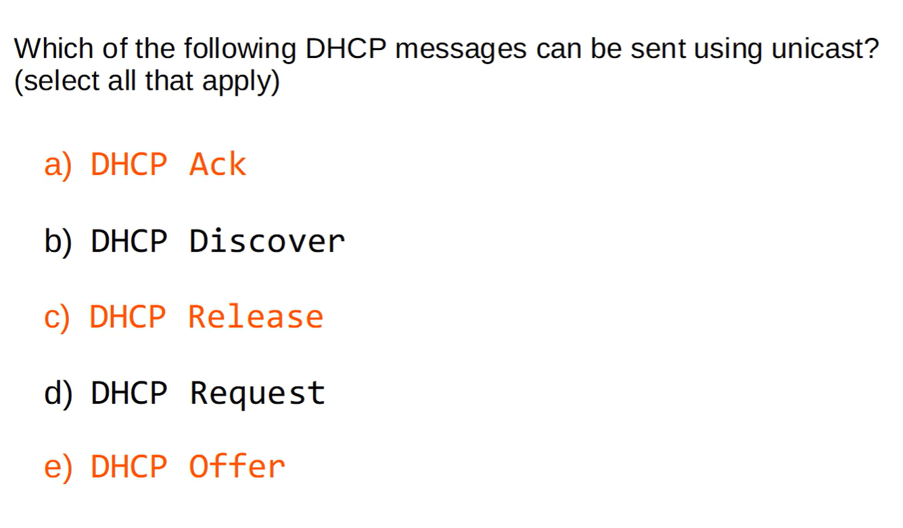

## DHCP — CCNA Notes

- DHCP: Automatically assigns IP address, subnet mask, default gateway, and DNS server.
- Lease: IP address assigned for a limited time.
- DORA: Discover → Offer → Request → Acknowledgment (ACK).
- UDP ports: Server = 67; Client = 68.
- DHCP Relay: Forwards client DHCP broadcasts to a remote DHCP server.

### Cisco IOS Commands

```
! DHCP Server
R1(config)# ip dhcp excluded-address 192.168.1.1 192.168.1.10 (not necessary but okay)
R1(config)# ip dhcp pool LAN
R1(dhcp-config)# network 192.168.1.0 /24
R1(dhcp-config)# default-router 192.168.1.1
R1(dhcp-config)# dns-server 8.8.8.8
R1(dhcp-config)# lease 0 5 30 (0days, 5hrs, 30mins)
R1# show ip dhcp binding

! DHCP Relay (client-facing interface)
interface g0/1
 ip helper-address 192.168.10.10
 show ip interface g0/1

! DHCP Client (interface configuration mode)
interface g0/1
 ip address dhcp
```

Remember: Routers forward DHCP broadcasts only when configured as a relay using `ip helper-address`. DHCP servers can assign addresses dynamically; excluded addresses are reserved for static use.

