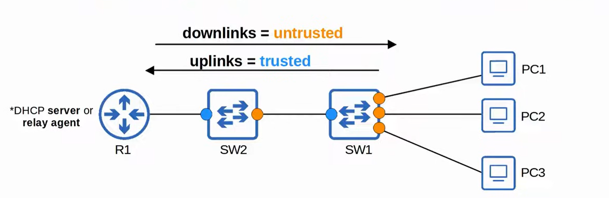

# CCNA Revision Notes: DHCP Snooping

## 1. What is DHCP Snooping?

DHCP Snooping is a Layer 2 switch security feature that filters DHCP messages received on untrusted ports.

- Protects against DHCP-based attacks.
- Filters DHCP messages only; other traffic is unaffected.
- All ports are untrusted by default.
- Uplink ports toward trusted network infrastructure are usually configured as trusted.
- Downlink ports toward end devices usually remain untrusted.

| Port type | DHCP snooping behavior                    |
| --------- | ----------------------------------------- |
| Trusted   | Forwards DHCP messages without inspection |
| Untrusted | Inspects DHCP messages and may drop them  |



## 2. DHCP Attacks

DHCP Starvation (Exhaustion)

- Attacker floods the DHCP server with Discover messages using spoofed MAC addresses.
- Fills the DHCP address pool.
- Legitimate clients cannot obtain IP addresses, causing a DoS.

DHCP Poisoning

- Attacker operates a rogue DHCP server.
- Sends clients incorrect network settings, such as the attacker's IP as the default gateway.
- Allows the attacker to intercept or modify traffic (MitM attack).

## 3. DHCP Message Types

Know which messages come from the server and which come from clients.

| DHCP server messages | DHCP client messages |
| -------------------- | -------------------- |
| OFFER                | DISCOVER             |
| ACK                  | REQUEST              |
| NAK                  | RELEASE              |
|                      | DECLINE              |

Important: Server messages received on untrusted ports are always dropped.

## 4. How DHCP Snooping Filters Messages

- Trusted port: Forward DHCP messages without inspection.
- Untrusted port: Inspect DHCP messages.

For client messages:

| Message            | Check performed                                                               |
| ------------------ | ----------------------------------------------------------------------------- |
| DISCOVER / REQUEST | Ethernet source MAC must match DHCP CHADDR (Client Hardware Address).         |
| RELEASE / DECLINE  | Source IP and receiving interface must match the DHCP snooping binding table. |

The DHCP snooping binding table records information when a client successfully leases an IP address:

- MAC address
- IP address
- Lease time
- VLAN
- Interface

View it with:

```
show ip dhcp snooping binding
```

## 5. DHCP Snooping Configuration

Know these commands

Enable DHCP snooping globally and for the required VLAN:

```
ip dhcp snooping
ip dhcp snooping vlan 1
```

Configure the interface connected to the legitimate DHCP server as trusted:

```
interface g0/0
 ip dhcp snooping trust
```

Remember: All ports are untrusted by default.

Disable automatic Option 82 insertion when needed:

```
no ip dhcp snooping information option
```

## 6. DHCP Snooping Rate Limiting

Limits how many DHCP messages an interface can receive per second.

```
interface g0/1
 ip dhcp snooping limit rate 10
```

- If the configured rate is exceeded, the interface becomes err-disabled.
- Helps protect against DHCP starvation attacks.
- The transcript uses a rate of 1 in its demonstration, but notes that this is too low for a real network.

Recovery commands:

```
errdisable recovery cause dhcp-rate-limit
show errdisable recovery
```

Manual recovery:

```
interface g0/1
 shutdown
 no shutdown
```

## 7. DHCP Option 82

- Also called the DHCP Relay Agent Information Option.
- Provides information about the relay agent, receiving interface, VLAN, and other details.
- Cisco switches can add Option 82 to DHCP messages when DHCP snooping is enabled.
- It can cause DHCP messages to be dropped when switches or servers handle the option inconsistently.

Command to disable automatic insertion:

```
no ip dhcp snooping information option
```

## CCNA Quick Review

| Topic              | Remember                                    |
| ------------------ | ------------------------------------------- |
| DHCP snooping      | Filters DHCP messages on untrusted ports    |
| Default port state | Untrusted                                   |
| Trusted ports      | Usually uplinks toward DHCP infrastructure  |
| Starvation         | Fills the DHCP pool                         |
| Poisoning          | Rogue DHCP server; can enable MitM          |
| DISCOVER / REQUEST | Check source MAC against CHADDR             |
| RELEASE / DECLINE  | Check against binding table                 |
| Binding table      | MAC, IP, lease, VLAN, interface             |
| Rate limiting      | Excess DHCP messages can cause err-disabled |
| Option 82          | Relay Agent Information Option              |

Main configuration commands to memorize: `ip dhcp snooping`, `ip dhcp snooping vlan`, `ip dhcp snooping trust`, and `ip dhcp snooping limit rate`.