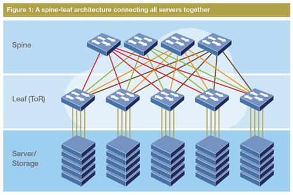

# CCNA Revision Notes: LAN Architectures

## 1. Network Topologies

| Topology     | Meaning                                               |
| ------------ | ----------------------------------------------------- |
| Star         | Multiple devices connect to one central device.       |
| Full mesh    | Every device connects directly to every other device. |
| Partial mesh | Some devices connect to each other, but not all.      |
| Hybrid       | Combination of different topologies.                  |

## 2. Two-Tier Campus LAN

Collapsed core

Two layers:

- Access layer
- Distribution layer

The core layer is omitted and its functions are combined with the distribution layer.

### Access layer

- End devices connect here: PCs, printers, cameras, IP phones and wireless APs.
- Usually has many switch ports.
- Performs QoS marking.
- Commonly provides security features:
  - Port Security
  - Dynamic ARP Inspection (DAI)
  - DHCP Snooping
- May provide PoE (Power over Ethernet).

### Distribution layer

- Aggregates connections from access switches.
- Usually uses a redundant pair of multilayer switches.
- Typically the boundary between Layer 2 and Layer 3.
- Runs Layer 2 protocols such as STP and Layer 3 protocols such as OSPF.
- Hosts often use distribution-layer SVIs as their default gateways.
- May use HSRP or VRRP for gateway redundancy.
- Connects to services such as the Internet and WAN.

Important: Access-to-distribution links are usually Layer 2, so STP prevents switching loops. Distribution-to-distribution links are Layer 3, so STP is not needed on those routed links.

## 3. Three-Tier Campus LAN

Three layers:

1. Access
2. Distribution
3. Core

A core layer is added to help scale large LANs, particularly when multiple distribution layers need to connect.

### Core layer

- Connects separate distribution layers.
- Acts as the LAN backbone.
- Focuses on fast packet forwarding (fast transport).
- Connections are Layer 3.
- Avoids CPU-intensive operations such as security features and QoS marking/classification.
- Requires high availability and redundant devices and connections.

Remember: Smaller LANs commonly use two tiers; larger LANs may use three tiers.

## 4. Spine-Leaf Architecture

Data center architecture

A two-tier architecture designed to handle high volumes of server-to-server traffic.

Traffic types:

- North-South: Traffic entering or leaving the data center, such as traffic to or from the Internet.
- East-West: Traffic between servers inside the data center.

Traditional three-tier designs can create bandwidth bottlenecks and inconsistent server-to-server latency as East-West traffic increases.

### Main Spine-Leaf rules

- Every leaf switch connects to every spine switch.
- Leaf switches do not connect directly to other leaf switches.
- Spine switches do not connect directly to other spine switches.
- End devices, such as servers, connect only to leaf switches.

### Key characteristics

- Traffic paths are selected to balance load across spine switches.
- Server-to-server paths generally have consistent hop counts and latency.
- Easy to scale: add another leaf switch and connect it to the existing spine switches.
- Also called Clos architecture.

## 5. SOHO Networks

SOHO = Small Office/Home Office

Small networks typically use one device, commonly called a home router or wireless router, to provide multiple networking functions:

| Function    | Purpose                                                       |
| ----------- | ------------------------------------------------------------- |
| Router      | Connects the local network to the Internet.                   |
| Switch      | Connects wired devices through Ethernet ports.                |
| Firewall    | Provides basic traffic filtering.                             |
| Wireless AP | Connects devices through Wi-Fi.                               |
| Modem       | May provide the Internet connection, depending on the device. |

A modem may also be a separate device.

## CCNA Quick Review

| Topic                     | Remember                                       |
| ------------------------- | ---------------------------------------------- |
| Two-tier                  | Access + Distribution                          |
| Two-tier alternative name | Collapsed core                                 |
| Three-tier                | Access + Distribution + Core                   |
| Access layer              | End devices, QoS marking, security, PoE        |
| Distribution layer        | Aggregation, Layer 2/3 boundary, routing       |
| Core layer                | Fast transport, Layer 3, redundancy            |
| Spine-leaf                | Every leaf connects to every spine             |
| Leaf switches             | Connect to end devices                         |
| Spine switches            | Do not connect to other spine switches         |
| North-South               | Traffic entering or leaving the data center    |
| East-West                 | Traffic between servers                        |
| SOHO                      | One device combines multiple network functions |

Most important exam distinctions: Know the purpose of each campus LAN layer, the difference between two-tier and three-tier designs, the spine-leaf connection rules, and the meaning of North-South versus East-West traffic.