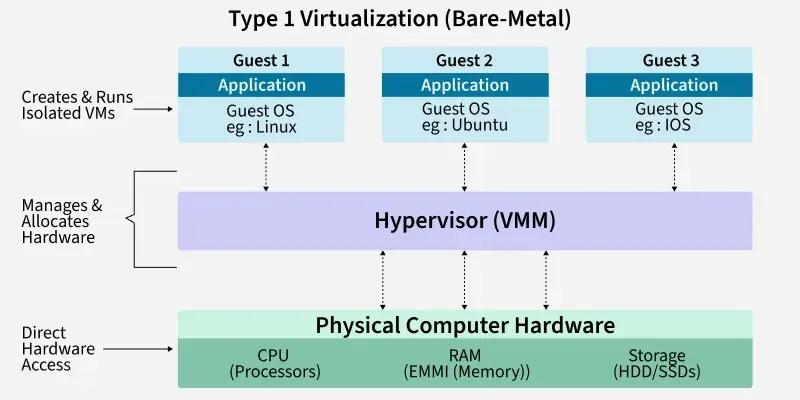
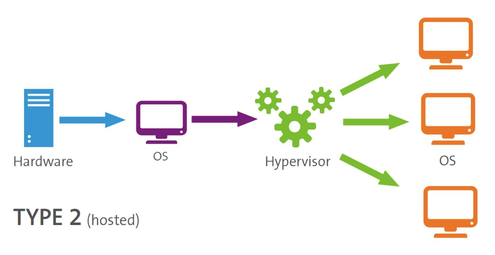

# CCNA Revision Notes — Virtualization & Cloud Computing

Jeremy's IT Lab · Exam topics 1.2.f and 1.12

## 1. Virtualization Fundamentals

Virtualization: Allows multiple operating systems (VMs) to run on one physical server.

- VM (Virtual Machine): Software-based computer with its own OS and applications.
- Hypervisor (VMM): Manages and allocates physical hardware resources (CPU, RAM, etc.) to VMs.

### Type 1 vs Type 2 Hypervisors

Type 1 — Bare-metal / Native

- Runs directly on physical hardware.
- Common in data centers.
- Examples: VMware ESXi, Microsoft Hyper-V.

Type 2 — Hosted

- Runs as an application on an existing OS.
- Common on personal computers.
- Examples: VMware Workstation, Oracle VirtualBox.
- Host OS: OS running on physical hardware.
- Guest OS: OS running inside a VM.

### Benefits of Virtualization

- Partitioning: Multiple OSs share one physical server.
- Isolation: Problems in one VM are isolated from others.
- Encapsulation: VMs can be copied, saved, and moved like files.
- Hardware independence: VMs can run on different compatible physical servers.
- Reduces hardware, power, cooling, and operating costs.
- Faster deployment and improved redundancy.

## 2. Virtual Networking

- VMs communicate through a virtual switch (vSwitch) running on the hypervisor.
- vSwitch ports support access and trunk configurations.
- VLANs separate VMs at Layer 2.
- Physical NICs connect the virtual switch to the external physical network.

Remember: vSwitch = virtual Layer 2 connectivity for VMs.

## 3. Traditional Infrastructure

| Model       | Description                                                                                    |
| ----------- | ---------------------------------------------------------------------------------------------- |
| On-premises | Company owns and operates infrastructure on its property.                                      |
| Colocation  | Company owns its equipment but rents data-center space, power, cooling, and physical security. |
| Cloud       | Computing resources provided as services over a network.                                       |

## 4. Five Essential Cloud Characteristics

Memorize all five — NIST cloud fundamentals.

| Characteristic         | Meaning                                                                         |
| ---------------------- | ------------------------------------------------------------------------------- |
| On-demand self-service | Customer provisions resources without contacting the provider.                  |
| Broad network access   | Services accessible over networks using different devices.                      |
| Resource pooling       | Provider shares computing resources among multiple customers (multi-tenancy).   |
| Rapid elasticity       | Quickly increase or decrease resources based on demand.                         |
| Measured service       | Resource usage is monitored and measured; customers are charged based on usage. |

Important: Cloud resources are not actually infinite. They only appear unlimited to customers.

## 5. Three Cloud Service Models

| Model | What the customer receives                        | Example                           |
| ----- | ------------------------------------------------- | --------------------------------- |
| SaaS  | Ready-to-use applications                         | Microsoft 365, Gmail              |
| PaaS  | Platform to develop and deploy applications       | Google App Engine, AWS Lambda     |
| IaaS  | Computing infrastructure (VMs, storage, networks) | Amazon EC2, Google Compute Engine |

Control comparison:

- SaaS: Provider manages almost everything; customer uses the application.
- PaaS: Provider manages infrastructure and OS; customer manages deployed applications.
- IaaS: Provider manages physical infrastructure; customer controls OSs, storage, and applications.

Exam memory tip

SaaS = Software, PaaS = Platform, IaaS = Infrastructure.

IaaS provides the most control to the customer.

## 6. Four Cloud Deployment Models

| Model     | Description                                                   |
| --------- | ------------------------------------------------------------- |
| Private   | Dedicated to one organization.                                |
| Community | Shared by organizations with common concerns or requirements. |
| Public    | Available for general public use.                             |
| Hybrid    | Combination of two or more distinct cloud infrastructures.    |

Important distinctions:

- Private cloud can be on-premises or off-premises.
- Community cloud serves a specific group of organizations.
- Public cloud providers include AWS, Azure, and GCP.
- Hybrid cloud can combine private and public clouds.

## 7. Benefits of Cloud Computing

- Cost: Reduces upfront capital expenses (CapEx); shifts toward operating expenses (OpEx).
- Scalability: Quickly expand resources globally.
- Speed and agility: Provision resources on demand.
- Productivity: Less physical hardware setup and maintenance.
- Reliability: Backups and geographic data replication support disaster recovery.

## 8. Connecting to Cloud Resources

Enterprises can connect to public cloud resources through:

- Private WAN connections, such as MPLS VPN.
- Public Internet connections.
- VPN over the Internet for secure communication.

Remember: Cloud connectivity also requires security and redundant connections to avoid single points of failure.

## CCNA Quick Recall

- Type 1 = Bare-metal; Type 2 = Hosted.
- Hypervisor manages and allocates VM hardware resources.
- Host OS vs Guest OS.
- vSwitch connects VMs and supports VLANs.
- Know on-premises vs colocation.
- Memorize five cloud characteristics.
- Memorize SaaS, PaaS, IaaS and their responsibility differences.
- Memorize private, community, public, hybrid.
- Know CapEx vs OpEx.
- Cloud resources can be reached through Internet or private WAN.

Exam traps to avoid:

1. Type 1 runs directly on hardware; Type 2 runs on a host OS.
2. Hypervisor allocates resources to VMs.
3. Infinite resource pool is NOT an essential cloud characteristic.
4. SaaS provides applications; PaaS provides a development platform; IaaS provides infrastructure.
5. Private cloud does not necessarily mean on-premises.
6. All four deployment models can exist off-premises.