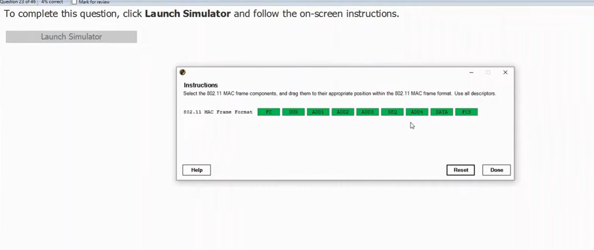
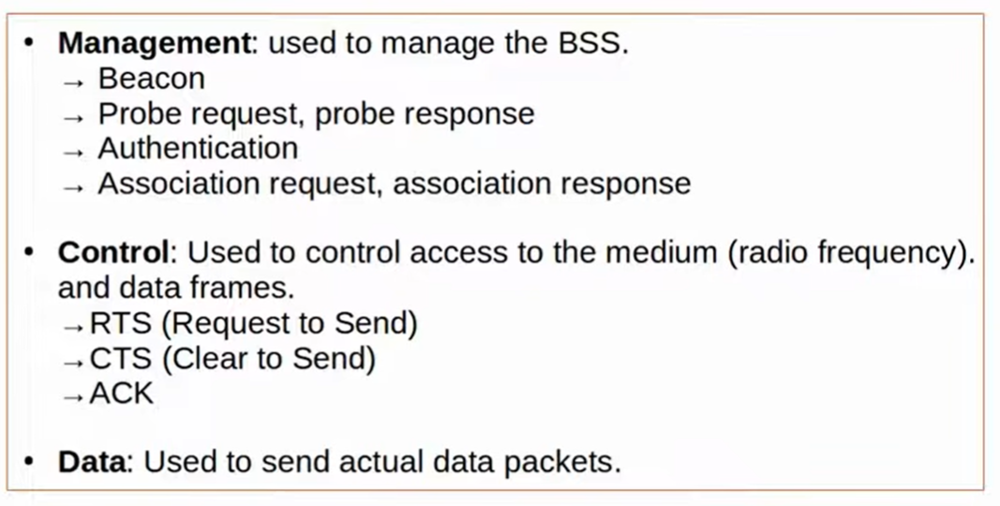
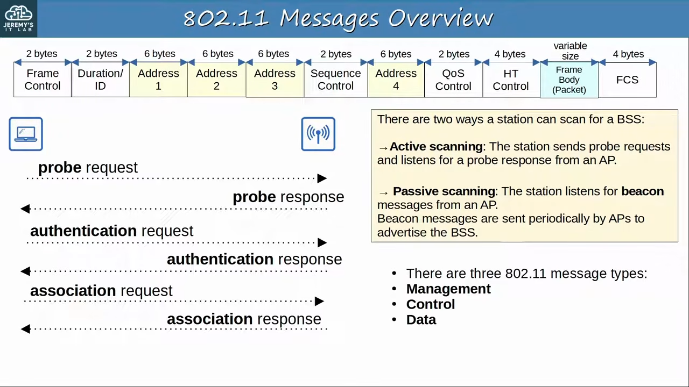
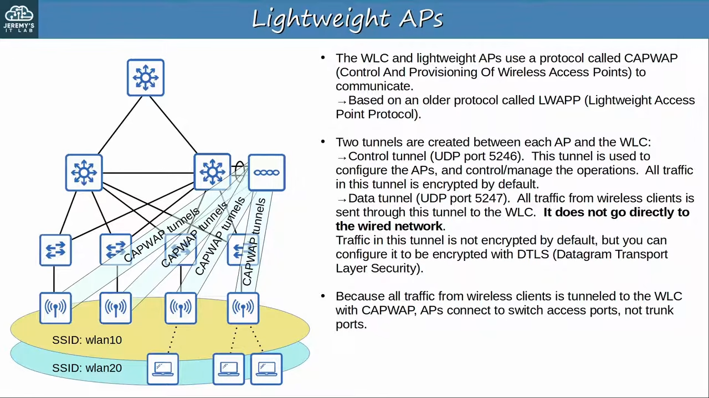

# CCNA Revision Notes: Wireless Architectures

## 1. 802.11 frame format

802.11 wireless frames have more header fields than 802.3 Ethernet frames. Not every field appears in every frame.

| Field            | Purpose                                            |
| ---------------- | -------------------------------------------------- |
| Frame Control    | Identifies message type and subtype                |
| Duration/ID      | Channel reservation time or association identifier |
| Address fields   | Up to four addresses: DA, SA, RA, TA               |
| Sequence Control | Reassembles fragments and eliminates duplicates    |
| QoS Control      | Prioritizes traffic                                |
| HT Control       | High Throughput operations (802.11n)               |
| Frame Body       | Encapsulated packet                                |
| FCS              | Detects frame errors                               |

know above bro

Four address fields:

- DA: Final destination.
- SA: Original source.
- RA: Immediate receiver.
- TA: Immediate transmitter.

## 2. 802.11 association process

A wireless client must be authenticated and associated with an AP before sending traffic through it.

Three connection states:

1. Not authenticated, not associated.
2. Authenticated, not associated.
3. Authenticated and associated.

Connection sequence:

1. Scanning: Discover available APs.
   - Active scanning: Client sends Probe Request; AP responds with Probe Response.
   - Passive scanning: Client listens for periodic Beacon messages from APs.
2. Authentication: Client and AP perform authentication exchange.
3. Association: Client sends Association Request; AP responds.
4. Client can now send traffic through the AP.

## 3. 802.11 message types

Exam fact: Probe Request is a management frame.

## 4. AP deployment architectures

| Architecture | Characteristics                                                               |
| ------------ | ----------------------------------------------------------------------------- |
| Autonomous   | Independent APs; individually configured; no central controller               |
| Lightweight  | Centrally managed by a WLC; uses CAPWAP                                       |
| Cloud-based  | Autonomous APs centrally managed through a cloud dashboard, e.g. Cisco Meraki |

### Autonomous AP

- Self-contained; no WLC required.
- Each AP configured individually (CLI, SSH, Telnet, HTTP/HTTPS).
- RF settings, security, ACLs and QoS configured per AP.
- Suitable for small networks.
- AP connects to switch using a trunk, carrying client VLANs and a separate management VLAN.
- Client traffic travels directly through the wired network, not through a WLC.

### Lightweight AP

- Uses split-MAC architecture: AP and WLC share AP functions.
- AP handles real-time RF operations, encryption/decryption, beacons and probes.
- WLC handles centralized RF management, security, QoS, authentication, association and roaming.
- Centrally configured and managed.
- AP and WLC authenticate using X.509 digital certificates.

CAPWAP (Control and Provisioning of Wireless Access Points) connects lightweight APs to the WLC.

| CAPWAP tunnel | UDP port | Purpose                                                   |
| ------------- | -------- | --------------------------------------------------------- |
| Control       | 5246     | AP configuration and management; encrypted by default     |
| Data          | 5247     | Carries wireless client traffic; not encrypted by default |

- Data tunnel encryption can be enabled using DTLS.
- DTLS is similar to TLS but uses UDP instead of TCP.
- Lightweight APs normally connect to switch access ports.
- WLC connects to the wired network using a trunk.

### Autonomous vs Lightweight traffic

| Autonomous AP             | Lightweight AP                       |
| ------------------------- | ------------------------------------ |
| Direct traffic forwarding | Client traffic tunneled to WLC       |
| AP connects via trunk     | AP normally connects via access port |
| No WLC required           | Requires WLC                         |
| Local-MAC architecture    | Split-MAC architecture               |

Even traffic between two clients associated with the same lightweight AP goes through the WLC first.

Benefits of lightweight architecture: Scalability, dynamic channel assignment, automatic transmit-power adjustment, self-healing coverage, seamless roaming, client load balancing, centralized security and QoS.

## 5. Lightweight AP operating modes

| Mode           | Purpose                                                                                                         |
| -------------- | --------------------------------------------------------------------------------------------------------------- |
| Local          | Default mode; provides BSS for wireless clients                                                                 |
| FlexConnect    | Provides BSS and locally forwards traffic if WLC connectivity fails                                             |
| Sniffer        | Captures 802.11 frames for analysis (e.g. Wireshark)                                                            |
| Monitor        | Detects rogue wireless devices; does not provide BSS                                                            |
| Rogue Detector | Uses wired-network ARP information and WLC rogue-device lists to identify rogue devices; does not use its radio |
| SE-Connect     | RF spectrum analysis across channels                                                                            |
| Bridge/Mesh    | Connects sites or APs wirelessly                                                                                |
| Flex + Bridge  | Bridge/mesh functionality plus local forwarding if WLC connectivity fails                                       |

Exam facts:

- Local and FlexConnect provide a BSS for clients.
- FlexConnect can locally forward traffic when WLC tunnels fail.
- Sniffer captures wireless frames; Monitor detects rogue wireless devices.
- Rogue Detector listens to wired traffic, not wireless RF.

## 6. Cloud-based AP architecture

Example: Cisco Meraki.

- Autonomous APs are centrally managed through a cloud dashboard.
- Cloud dashboard handles configuration, monitoring and performance reports.
- Management/control traffic goes to the cloud.
- Regular user data travels directly to its destination, not through the cloud.

Key distinction: Cloud-based AP architecture is not the same as a cloud-based WLC deployment.

## 7. WLC deployment models

These deployment models apply to lightweight AP / split-MAC architecture.

| WLC deployment         | Where WLC runs                          | Approx. AP capacity |
| ---------------------- | --------------------------------------- | ------------------- |
| Unified                | Separate hardware appliance             | 6,000               |
| Cloud-based WLC        | VM on a server, typically private cloud | 3,000               |
| Embedded               | Integrated into a switch                | 200                 |
| Cisco Mobility Express | Integrated into an AP                   | 100                 |

- Unified: Suitable for large enterprise campuses.
- Cloud-based WLC: Lightweight APs; cloud-based refers to the WLC's location.
- Embedded: Suitable for smaller campuses.
- Mobility Express: Suitable for small branch offices.

## Must-remember exam facts

- Probe Request = Management frame.
- Three 802.11 message types: Management, Control, Data.
- Active scanning = Probe Request/Response; passive scanning = Beacon.
- Client must authenticate and associate before sending traffic.
- CAPWAP control = UDP 5246; data = UDP 5247.
- Control tunnel encrypted by default; data tunnel not encrypted by default.
- Autonomous AP = trunk; lightweight AP = access port; WLC = trunk.
- Lightweight AP = split-MAC; autonomous AP = local-MAC.
- Local and FlexConnect provide BSS.
- FlexConnect supports local forwarding if WLC connectivity fails.
- Meraki cloud manages APs, but user data does not travel through the cloud.
- WLC capacity ranking: Unified (6,000) > Cloud (3,000) > Embedded (200) > Mobility Express (100).