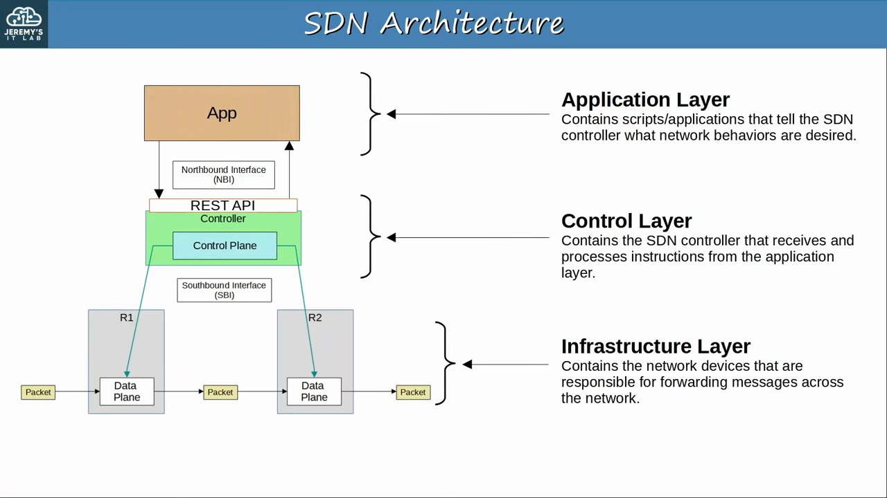

# **CCNA Revision Notes: SD-Access and DNA Center**

## **1. SDN Architecture**

**SDN (Software-Defined Networking):** Centralizes some or all control-plane functions in an SDN controller.

| Layer          | Function                                              |
| -------------- | ----------------------------------------------------- |
| Application    | Scripts and applications that instruct the controller |
| Control        | SDN controller                                        |
| Infrastructure | Physical network devices that forward traffic         |

- **Northbound interface:** Applications/scripts communicate with the controller.
- **Southbound interface:** Controller communicates with network devices.
- SDN controllers can centralize all or only some control-plane functions.

## **2. Cisco SDN Solutions**

| Solution      | Purpose                                    |
| ------------- | ------------------------------------------ |
| **SD-Access** | Automates campus LANs (wired and wireless) |
| **ACI**       | Automates data center networks             |
| **SD-WAN**    | Automates WANs                             |

\- Cisco DNA Center is the controller used by SD-Access.

## **3. Underlay, Overlay and Fabric**

[Design Zone - Software-Defined Access - Cisco](https://images.openai.com/static-rsc-4/vwUMis4UxAxtq47h6ZnhmOyir9VyI_nAoa17iDCniJ82VxOJKxXFuUzMAf1JWOi_SKaMNxmNGnn2gLQVRlKmeArr0dodTHQY0F1NGAWYdjRCw5no1qJAmB3V2zzjVdKJEb9fIbkysNdqnRQrO-hN8sesJ5v4Bjp-hG42bibj0Mg?purpose=inline)

[cisco.com](https://www.cisco.com/c/en/us/td/docs/solutions/CVD/Campus/cisco-sda-design-guide.html?utm_source=chatgpt.com)

| Term         | Meaning                                                                     |
| ------------ | --------------------------------------------------------------------------- |
| **Underlay** | Physical network: devices, cables, wireless connections and IP connectivity |
| **Overlay**  | Virtual network built on top of the underlay                                |
| **Fabric**   | Combination of the underlay and overlay                                     |

- SD-Access uses **IS-IS** in its example underlay.
- **VXLAN** creates virtual tunnels in the overlay.
- Both underlay and overlay are needed for the fabric.

## **4. SD-Access Switch Roles**

| Role             | Function                                           |
| ---------------- | -------------------------------------------------- |
| **Edge node**    | Connects end hosts; similar to an access switch    |
| **Border node**  | Connects the SD-Access fabric to external networks |
| **Control node** | Supports control-plane functions using LISP        |

**Remember:** Edge, Border, Control. These are the three switch roles.

## **5. SD-Access Underlay**

- Underlay provides connectivity needed to support overlay VXLAN tunnels.
- In an optimal greenfield deployment:
  - All switches are Layer 3.
  - IS-IS exchanges routing information.
  - All inter-switch links are routed ports.
  - STP is not needed because there are no Layer 2 loops.
  - Edge switches act as default gateways for end hosts.
- This is called a **routed access layer**.

**Deployment types:**

- **Greenfield:** A completely new network; DNA Center configures the underlay.
- **Brownfield:** SD-Access added to an existing network; DNA Center does not configure the existing underlay in the example.

## **6. SD-Access Overlay**

Know these three technologies:

| Technology               | Function                                       |
| ------------------------ | ---------------------------------------------- |
| **LISP**                 | Control plane                                  |
| **Cisco TrustSec (CTS)** | Policy control                                 |
| **VXLAN**                | Data plane; creates tunnels to forward traffic |

LISP terminology:

- **EID (Endpoint Identifier):** Identifies an end host.
- **RLOC (Routing Locator):** Identifies the edge switch used to reach that host.
- LISP maintains EID-to-RLOC mappings.

Basic operation: A control node provides the mapping that tells an edge switch which other edge switch can reach the destination. Traffic then travels through a VXLAN tunnel.

## **7. Cisco DNA Center**

- Software application installed on Cisco UCS server hardware.
- Acts as the SDN controller in SD-Access.
- Can also manage traditional networks without SD-Access.
- Provides a GUI and REST API.
- Southbound interfaces support:
  - NETCONF
  - RESTCONF
  - Telnet
  - SSH
  - SNMP

**Intent-Based Networking (IBN):**

- Engineer specifies the desired network behavior.
- DNA Center translates that intent into device configurations and policies.
- Centralizes policy management instead of configuring devices individually.

Other DNA Center functions include device inventory, software compliance, network design, provisioning and network health monitoring.

## **8. DNA Center vs Traditional Network Management**

| Traditional management                           | DNA Center management                            |
| ------------------------------------------------ | ------------------------------------------------ |
| Configure devices individually using SSH/console | Centrally manage devices                         |
| Policies configured per device                   | Policies centrally managed                       |
| Manual device deployment                         | Devices can receive configurations automatically |
| More manual effort and potential errors          | Faster deployment and fewer manual errors        |
| Distributed configuration management             | Centralized monitoring and configuration         |

## **9. CCNA Exam Priorities**

High priority

- Underlay = physical network.
- Overlay = virtual network built on top.
- Fabric = underlay + overlay.
- Application, Control and Infrastructure layers.
- SD-Access = campus LAN automation.
- VXLAN = overlay tunnels / data plane.
- LISP = control plane.
- Cisco TrustSec = policy control.
- Edge, Border and Control = three SD-Access switch roles.
- Optimal SD-Access underlay = Layer 3 links; STP not required.
- DNA Center = SDN controller and centralized network management.

1. Physical network = Underlay.
2. Scripts interacting with controller = Application layer.
3. Optimal underlay = All inter-switch links are Layer 3.
4. Virtual tunnels = VXLAN.
5. Switch roles = Edge, Border and Control.
